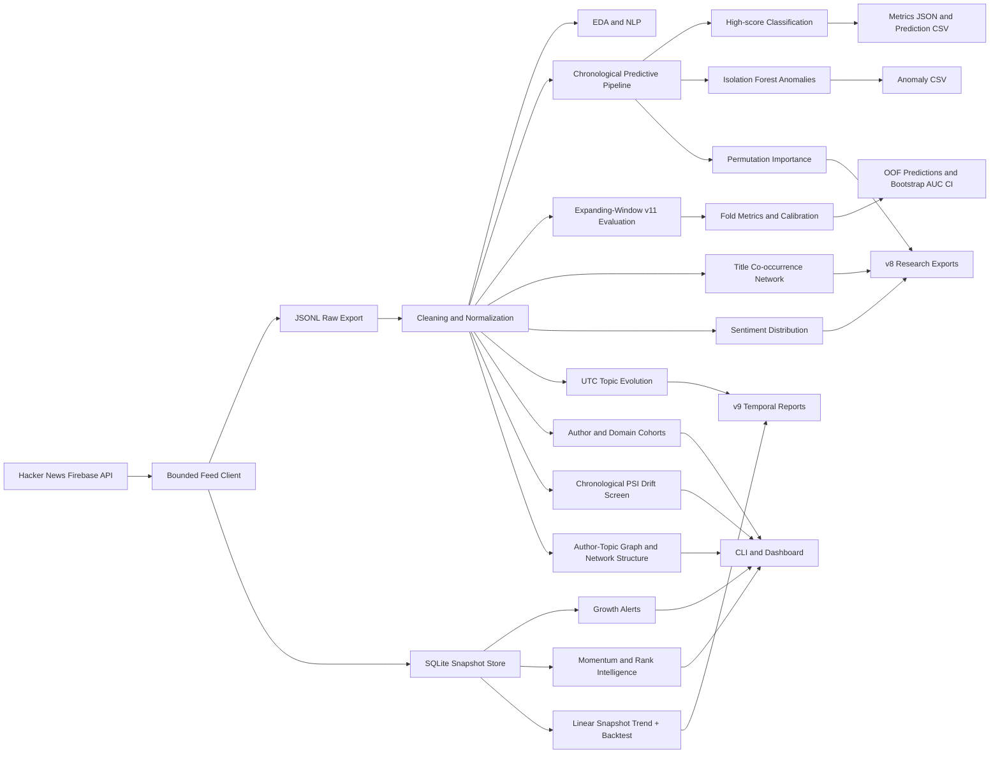

# HackerNews Analytics Pro — v18.19.0

A reproducible Hacker News analytics workbench combining data cleaning, exploratory statistics, NLP baselines, live collection, SQLite snapshot monitoring, predictive research, chronological model benchmarking, walk-forward validation, **author/domain cohort profiling and chronological drift screening**. v15 adds author-topic graph analysis; v16 adds **weighted PageRank and threshold-based author overlap communities**.

## What's new in v18.19.0 — Dashboard: Search & compare tab

- **New dashboard tab "Search & compare v18"** (run with `streamlit run hn_dashboard.py`):
  - keyword, minimum-points, sort and last-N-days search with CSV download, using the same logic as `query`
  - a digest preview that follows the same keyword and day filters
  - summary statistics with top domains and authors
  - a comparison of the earlier and later halves of the loaded dataset
- **Logic is separate from the UI:** `hn_dashboard_v18.py` holds the functions and is unit-tested without Streamlit.
- **Not run in this release:** Streamlit is an optional dependency and was not installed in the build environment, so the tab was checked by compiling and by testing its helper functions, not by launching the app. The smoke test now expects 15 tabs and runs where Streamlit is installed.
- **Tests:** `test_v18_dashboard_helpers.py`.

## What's new in v18.18.0 — Day window for the digest

- **`digest --days N`** limits the digest to the last N days, using the same newest-story anchor as `query --days`.
- **Tests:** `test_v18_digest_days.py`.

```bash
hn-analytics digest --input demo_stories.jsonl --days 7 --output-dir reports
```

## What's new in v18.17.0 — Relative day window

- **`query --days N`** keeps stories from the last N days. The window ends at the newest story in the dataset, not the current clock, so rerunning on the same file gives the same results.
- **Tests:** `test_v18_days.py`, including a check that shifting every timestamp leaves the window unchanged.

```bash
hn-analytics query --input demo_stories.jsonl --keyword python --days 7 --format json
```

## What's new in v18.16.0 — Dataset comparison

- **`hn-analytics compare --baseline A.jsonl --candidate B.jsonl`** reports the story counts, the change in median score and median comments, and the domains whose share of stories shifted the most. Use `--format json` for scripts.
- Descriptive only: no significance test, and no adjustment for story age, exposure or feed selection.
- **Tests:** `test_v18_compare.py`.

```bash
hn-analytics compare --baseline week1.jsonl --candidate week2.jsonl --top-n 5
```

## What's new in v18.15.0 — Dataset summary command

- **`hn-analytics stats`** summarises a dataset: story and scored-story counts, score and comment quantiles (min, median, p90, max), time range, and the top domains and authors. `--format json` gives the same data for scripts.
- Descriptive only: summaries do not control for story age or exposure.
- **Tests:** `test_v18_stats.py`.

```bash
hn-analytics stats --input demo_stories.jsonl --top-n 5 --format json
```

## What's new in v18.14.0 — Topic digests and CSV to stdout

- **`digest --keyword`** (repeatable) limits the digest to stories whose titles contain every term. If nothing matches, the sections say so.
- **`query --format csv`** prints CSV to stdout for piping into other tools.
- **Tests:** `test_v18_features_14.py`.

```bash
hn-analytics digest --input demo_stories.jsonl --keyword rust --output-dir reports
hn-analytics query --input demo_stories.jsonl --keyword python --format csv > python.csv
```

## What's new in v18.13.0 — Exclusions and counts

- **`query --exclude-keyword`** (repeatable) drops stories whose titles contain a term; it combines with `--keyword`.
- **`query --count`** prints only the number of matching stories. It ignores `--limit`, so the count is the full total.
- **Tests:** `test_v18_features_13.py`.

```bash
hn-analytics query --input demo_stories.jsonl --keyword rust --exclude-keyword patterns --count
```

## What's new in v18.12.0 — Scriptable watch and doctor output

- **`watch --format json`** prints matching stored stories as JSON with numeric fields kept numeric; **`watch --output file.csv`** writes CSV.
- **`doctor --json`** prints the environment checks as JSON, with exit status 1 on blocking problems.
- **Tests:** `test_v18_features_12.py`.

```bash
hn-analytics watch --db hn_monitor.sqlite --keyword rust --format json
hn-analytics doctor --json
```

## What's new in v18.11.0 — Sorting, JSON output, most-discussed digest

- **`query --sort score|comments|time`** orders results by points, comment count, or newest first.
- **`query --format json`** prints results as JSON to stdout (for scripts); `--output` still writes CSV.
- **Digest:** a new "Most discussed stories" section lists stories by comment count, excluding stories with none.
- **Tests:** `test_v18_features_11.py`.

```bash
hn-analytics query --input demo_stories.jsonl --keyword rust --sort comments --format json
```

## What's new in v18.10.0 — Installable wheel release

- **Packaging:** the project builds a wheel (`hackernews_analytics_pro-18.10.0-py3-none-any.whl`) that installs the `hn-analytics` command and the `hn_analytics` package with no source tree needed.
- **Verified:** the wheel was installed into a clean virtual environment and the CLI ran from outside the project directory.
- **Install:** `pip install dist/hackernews_analytics_pro-18.10.0-py3-none-any.whl` (add extras such as `[viz]` or `[dashboard]` as needed).

## What's new in v18.9.0 — Significance of the classifier's AUC

- **Permutation test:** `research` and the classifier now report `roc_auc_permutation_p_value` and `roc_auc_null_95th_percentile`. Holdout labels are shuffled 200 times (seeded) and AUC recomputed; the p-value is the share of shuffled AUCs at or above the observed one, with the +1 correction.
- **Limitation:** this checks the fitted model against chance on the one chronological holdout. It does not account for earlier tuning or model selection, and a small holdout gives coarse p-values (minimum about 1/201 here).
- **Tests:** `test_v18_significance.py`.

## What's new in v18.8.0 — Compressed inputs, filtered home page

- **Data:** `.csv.gz`, `.json.gz`, `.jsonl.gz` and `.ndjson.gz` inputs load directly.
- **Interface:** the `serve` home page has a keyword and minimum-score filter; results and the query echo are HTML-escaped.
- **Tests:** `test_v18_inputs_and_index.py`.
- **Release notes:** the full history is now also in `CHANGELOG.md`.

## What's new in v18.7.0 — Server input hardening

- **Fix:** `/api/query` accepted any `limit`, so a very large value could return the whole dataset. `limit` must now be an integer from 1 to 500.
- **Fix:** `min_score=nan` and `min_score=inf` were accepted silently. Non-numeric and non-finite scores now return HTTP 400.
- **Tests:** five new cases in `test_v18_server.py`.

## What's new in v18.6.0 — Local web server

- **`hn-analytics serve`** runs a read-only local server on `127.0.0.1:8000` (standard library only, no new dependencies):
  - `/` renders the digest page
  - `/api/query?keyword=rust&min_score=100&limit=20` returns JSON results
  - `/api/doctor` returns environment checks as JSON
- **Safety:** binds to loopback only; non-loopback hosts are refused. Responses send `nosniff` and a restrictive Content-Security-Policy. There is no authentication, so do not expose it publicly.
- **Tests:** `test_v18_server.py` makes real HTTP requests to an ephemeral port.

```bash
hn-analytics serve --port 8000 --input demo_stories.jsonl --db hn_monitor.sqlite
```

## What's new in v18.5.0 — HTML digest

- **`hn-analytics digest --format html`** writes a standalone, mobile-friendly `digest.html` with dark-mode styling.
- **Escaping:** all titles, authors and URLs are HTML-escaped before markup is added, and only `http`/`https` links become anchors.
- **Tests:** `test_v18_html_digest.py`.

```bash
hn-analytics digest --input demo_stories.jsonl --output-dir reports --format html
```

## What's new in v18.4.0 — Environment doctor and CI smoke tests

- **`hn-analytics doctor`** checks the Python version, required and optional packages, sample data and the SQLite schema. Missing required packages or an unsupported Python exit with status 1; missing optional extras are warnings only.
- **CI:** the workflow now runs `--version`, `doctor`, `digest` and `query` on every push, in addition to the unit tests.
- **Tests:** `test_v18_doctor.py`.

```bash
hn-analytics doctor
```

## What's new in v18.3.0 — Query and watch

- **`hn-analytics query`** filters a dataset by title keywords (repeatable; all must match, case-insensitive, literal), domain, author, minimum score and UTC date, then prints a table or writes CSV with `--output`.
- **`hn-analytics watch`** lists stories in the SQLite snapshot history whose latest observation matches the keywords, with score and comment counts.
- **Tests:** `test_v18_query.py`.

```bash
hn-analytics query --input demo_stories.jsonl --keyword rust --min-score 100 --since 2026-01-01 --output reports/rust.csv
hn-analytics watch --db hn_monitor.sqlite --keyword rust --lookback-hours 24
```

## What's new in v18.2.0 — Digest briefing

- **New command:** `hn-analytics digest` writes `digest.md`, a Markdown briefing with the top stories by score and the fastest-rising stories from SQLite momentum history.
- **Graceful inputs:** either source may be missing; the digest states which sections have no data instead of failing.
- **Safe links:** only `http`/`https` URLs are linked, so unusual schemes in source data are not rendered as clickable links.
- **Tests:** `test_v18_digest.py`.

```bash
hn-analytics digest --input demo_stories.jsonl --db hn_monitor.sqlite --output-dir reports --top-n 10
```

## What's new in v18.1.0 — Resilient live collection

- **Retries with backoff:** timeouts, connection errors and HTTP 429/5xx are retried up to `max_retries` (default 3) with exponential backoff. Other 4xx responses are not retried.
- **Per-item isolation:** a story that still fails is skipped and recorded in `client.failures`; the rest of the feed is kept. `fetch` and `monitor` report how many items were skipped.
- **Bounded concurrency:** items are fetched with up to `max_workers` threads (default 4, range 1–16). Output order matches the feed order.
- **CLI:** `hn-analytics --version`.
- **Tests:** `test_v18_live_client.py` exercises all of this offline with a scripted session.

## What's new in v18.0.0 — Data integrity fixes

- **Fix (data loss):** cleaning deduplicated on `id` with `drop_duplicates`, which collapsed every row lacking an `id` into one. Rows without an id are now kept; only exact duplicates among them are removed, and duplicate ids are still removed.
- **Fix (corrupt author/title values):** snapshot storage and temporal topic output wrote missing values as the literal string `"nan"`. Those values would have surfaced as a real author named `nan` in cohort and graph analyses. Missing text is now stored as an empty string.
- **Migration note:** databases created by earlier versions may already contain `"nan"` strings. They are not rewritten automatically; to clear them, run `UPDATE story_snapshots SET by_author = '' WHERE by_author = 'nan';` (and likewise for `title` and `url`) on your SQLite file.
- **Docs:** the architecture diagram is rewritten so each node has a single label and role.
- **Tests:** `test_v18_data_integrity.py` covers both fixes.

## What's new in v17.1.1

- **Fix:** `requests` is now a declared dependency. `hn_analytics` imports it at load time, so a clean `pip install .` previously failed on import.
- **Extras:** `pip install .[viz]`, `.[dashboard]`, `.[ai]`, `.[spark]` for optional features.
- **Pins:** the `pandas<3.0` cap is removed from `requirements.txt` (the suite passes on pandas 3.0.6) and kept only for Spark, whose pandas 3 support I could not verify.
- **Test:** a regression test checks that third-party imports in the core package are declared.

## What's new in v17.1.0

- **Dashboard:** new "Network structure v16-v17" tab runs PageRank, overlap communities, bootstrap stability, damping sensitivity and bridge scores interactively, with CSV/JSON downloads.
- **CI:** GitHub Actions workflow runs the test suite on Python 3.10-3.13.
- **Tests:** dashboard smoke test (skipped if Streamlit is not installed).

## What's new in v17.0 — Network Robustness Intelligence

- **Bootstrap rank stability:** resamples stories (topic labels fixed, seeded) and reports PageRank 95% intervals, presence rate and top-k membership frequency per author.
- **Damping sensitivity:** Spearman correlation and top-k overlap across damping values.
- **Bridge scores:** Brandes betweenness for author and topic nodes.
- **CLI:** `hn-analytics robustness --repeats 200 --top-k 5 --seed 42`
- **Notebook:** `16_Network_Robustness_Intelligence_v17.ipynb`.
- **Fix:** `requirements-dashboard.txt` contained a literal `\n` and could not be installed; it is now a valid requirements file.

Outputs: `v17_author_stability.csv`, `v17_damping_sensitivity.csv`, `v17_topic_bridges.csv`, `v17_robustness_summary.json`. Stability describes structural rankings only, not influence.

## What's new in v16.0 — Network Structure Intelligence

- **Weighted PageRank:** ranks author and topic nodes in the v15 bipartite graph using story-count edge weights and a configurable damping factor.
- **Author overlap communities:** groups authors into connected components after thresholding weighted-Jaccard topic-profile similarity.
- **Inspectable exports:** author/topic ranking CSVs, community CSV, enriched graph JSON and methodology summary.
- **CLI:** `hn-analytics network` runs the complete workflow.
- **Notebook:** `15_Network_Structure_Intelligence_v16.ipynb` demonstrates the analysis and ranking plot.

Run it:

```bash
hn-analytics network --input demo_stories.jsonl --output-dir reports --clusters 5 --backend tfidf --similarity-threshold 0.15 --damping 0.85
```

Outputs: `v16_author_pagerank.csv`, `v16_topic_pagerank.csv`, `v16_overlap_communities.csv`, `v16_network_graph.json` and `v16_network_summary.json`. PageRank is structural prominence in this constructed network, not real-world influence. Communities are threshold-dependent connected components of shared topic-profile similarity; they do not imply collaboration, friendship, endorsement or causality. The bundled sample is synthetic and is suitable for a smoke test, not substantive conclusions.

## What's new in v15.0 — Author-Topic Graph Intelligence

- **Bipartite author/topic graph:** connects each named author to the exploratory topic clusters represented in their stories; edge weights count observed stories.
- **Author graph metrics:** story count, distinct topic count, weighted degree, topic entropy, normalized topic entropy and descriptive score summaries.
- **Topic graph metrics:** story count, unique author count and mean score by topic cluster.
- **Author overlap projection:** weighted-Jaccard similarity compares each author's distribution of stories across topics and reports pairs with at least one shared topic.
- **Graph exports:** JSON nodes/links plus CSV author metrics, topic metrics, author-topic edges and author-overlap pairs.
- **CLI:** `hn-analytics graph` runs the v15 workflow.
- **Dashboard:** adds an Author-topic graph v15 tab with metrics, a 3D author-profile scatter plot and downloadable graph data.
- **Notebook:** `14_Author_Topic_Graph_Intelligence_v15.ipynb` demonstrates graph construction and exports.

Run v15 with the offline TF-IDF topic representation:

```bash
hn-analytics graph --input demo_stories.jsonl --output-dir reports --clusters 5 --backend tfidf
```

Use `--backend auto` to allow optional Sentence-Transformers embeddings with fallback, or `--backend sentence-transformers` to require that model backend. Outputs: `v15_author_graph_metrics.csv`, `v15_topic_graph_metrics.csv`, `v15_author_topic_edges.csv`, `v15_author_topic_overlap.csv`, `v15_author_topic_graph.json` and `v15_graph_summary.json`.

### v15 interpretation and limitations

- Author-topic edges represent observed authorship of stories assigned to exploratory text clusters. They do **not** indicate collaboration, social relationships, endorsement, influence or causality.
- The author projection measures similarity of topic participation profiles using weighted Jaccard; it is not a social network and does not establish that two authors interacted.
- Topic assignments depend on the selected TF-IDF or Sentence-Transformer representation and KMeans configuration. Cluster IDs are arbitrary and cluster labels are not ground truth.
- Mean scores are descriptive and confounded by story age, exposure, feed selection and topic composition. Avoid interpreting them as intrinsic author quality.

## What's new in v14.0 — Semantic Discovery & Topic Clustering

- **Optional contextual embeddings:** Sentence-Transformers backend for semantic story representations; `auto` mode records a TF-IDF fallback if the optional dependency or model cannot load.
- **Diversified recommendations:** maximal marginal relevance (MMR) balances query relevance and redundancy.
- **Topic discovery:** KMeans clustering over the selected representation with representative story titles and per-story assignments.
- **CLI:** `hn-analytics semantic` exports recommendation, topic, assignment and metadata files.
- **Dashboard and notebook:** v14 semantic discovery panel and `13_Semantic_Intelligence_v14.ipynb`.

Run the v14 workflow:

```bash
pip install -r requirements.txt
pip install -r requirements-ai.txt  # optional Sentence-Transformers backend
hn-analytics semantic --input demo_stories.jsonl --output-dir reports --backend auto
```

The optional model may download weights on first use. Use `--backend tfidf` for offline operation or `--backend sentence-transformers` to require embeddings without fallback.

## What's new in v13.0 — Story Recommendations & Near-Duplicate Discovery

- **Content-based recommendations:** TF-IDF word/bigram features rank stories by cosine similarity to a selected seed story.
- **Near-duplicate candidates:** sparse pairwise cosine similarity surfaces title/text pairs for manual review without deleting or merging records.
- **Optional text enrichment:** uses available `text`, `description` or `selftext` fields, capped to keep long bodies from dominating titles.
- **CLI:** `hn-analytics recommend` exports recommendation, candidate-pair and methodology files.
- **Dashboard:** expandable v13 story recommendation and duplicate-review panel.
- **Notebook:** `12_Story_Recommendations_v13.ipynb` demonstrates ranking, candidate review and visualization.

Run the v13 workflow:

```bash
hn-analytics recommend --input demo_stories.jsonl --output-dir reports --seed-index 0 --top-k 10 --min-similarity 0.05 --duplicate-threshold 0.75
```

Outputs: `v13_story_recommendations.csv`, `v13_near_duplicates.csv` and `v13_recommendation_summary.json`. Similarity is lexical rather than contextual semantic similarity; candidate pairs require human review.

## What's new in v12.0 — Cohort & Drift Intelligence

- **Author cohorts:** story counts, total/mean/median points, mean comments, top-decile score rate and Wilson 95% intervals.
- **Domain cohorts:** the same descriptive engagement summaries grouped by URL domain.
- **Chronological drift:** Population Stability Index (PSI) screening for scores, comments and title length, comparing earlier and later records.
- **CLI:** `hn-analytics profile` exports author, domain, drift and methodology artifacts.
- **Dashboard:** adds a Cohorts & Drift v12 tab.
- **Notebook:** `11_Cohort_Drift_Intelligence_v12.ipynb` demonstrates the workflow.

Run the v12 workflow:

```bash
hn-analytics profile --input demo_stories.jsonl --output-dir reports --min-stories 3 --reference-fraction 0.5
```

Outputs: `v12_author_cohorts.csv`, `v12_domain_cohorts.csv`, `v12_drift_report.csv` and `v12_profile_metadata.json`. PSI labels use heuristic bands (<0.10 low, 0.10–0.25 moderate, ≥0.25 high); they are screening guidance, not universal thresholds or proof of model degradation. Cohort comparisons are descriptive and do not control for story age, exposure, selection bias or confounding.

## What's new in v11.0 — Walk-Forward Validation & Calibration Diagnostics

- **Expanding-window evaluation:** evaluates Logistic Regression, Random Forest and Extra Trees over multiple chronological holdout folds rather than relying on one split.
- **Fold-local target threshold:** each fold computes its high-score threshold from training-period scores only; the same threshold is applied to that fold's later test block.
- **Probability diagnostics:** Brier score, log loss and equal-width expected calibration error complement ROC-AUC, average precision, precision, recall and F1.
- **Uncertainty estimate:** pooled out-of-fold ROC-AUC percentile bootstrap interval, with the number of resamples recorded in metadata.
- **Leakage controls:** score and comment counts are excluded from predictor features; text/category/numeric preprocessing is fitted separately within each fold.
- **CLI:** `hn-analytics walkforward` exports summary, fold-level metrics, out-of-fold predictions and methodology metadata.
- **Dashboard:** adds a Walk-forward v11 tab with fold comparisons and calibration diagnostics.
- **Notebook:** `10_Walk_Forward_Validation_v11.ipynb` demonstrates the complete research workflow.

Run the v11 workflow:

```bash
hn-analytics walkforward --input demo_stories.jsonl --output-dir reports --folds 3 --test-fraction 0.15
```

Outputs: `v11_walkforward_model_summary.csv`, `v11_walkforward_fold_metrics.csv`, `v11_walkforward_predictions.csv` and `v11_walkforward_metadata.json`. Use at least 60 scored rows; larger and representative chronological datasets are strongly recommended. Single-class test folds have undefined ROC-AUC and average precision.

## Retained v10.0 — Chronological Model Benchmarking

- **Three-model comparison:** Logistic Regression, Random Forest and Extra Trees run on the same chronological holdout.
- **Leakage controls:** preprocessing is fitted on training rows only; the high-score threshold is derived from training scores only; score and comment counts are excluded from predictors.
- **Evaluation:** accuracy, precision, recall, F1, ROC-AUC, average precision and Brier score.
- **Exports:** model leaderboard CSV, per-model holdout predictions CSV and methodology JSON.
- **CLI:** `hn-analytics benchmark` runs the benchmark; the Streamlit dashboard adds a Model Benchmark v10 tab.
- **Notebook:** `09_Model_Benchmarking_v10.ipynb` provides a reproducible walkthrough.

Run against a dataset with at least 60 scored stories and both classes represented in chronological train and test partitions:

```bash
hn-analytics benchmark --input your_stories.jsonl --output-dir reports
```

Outputs: `v10_model_leaderboard.csv`, `v10_model_predictions.csv` and `v10_benchmark_summary.json`. This is a single retrospective chronological holdout, not rolling-origin validation or a guarantee of future performance. Larger, representative datasets are recommended.

## What's new in v9.0 — Temporal Intelligence

- **Topic evolution:** counts title tokens across UTC day/week/month buckets. This is lexical frequency analysis, not semantic topic modelling.
- **Snapshot trend projections:** fits a per-story least-squares line to repeated score/comment observations and projects a user-selected horizon. It is a transparent descriptive baseline, not a trained neural forecasting model.
- **Chronological backtest:** holds out the last observation per story and compares linear-trend error with a persistence baseline using MAE/RMSE. Requires at least four valid snapshots per story.
- **CLI:** `hn-analytics temporal` exports topic evolution; add `--db` to include projections and backtest metrics.
- **Dashboard:** new Temporal Intelligence tab with topic trends and optional SQLite projections.
- **Notebook:** `08_Temporal_Intelligence_v9.ipynb` demonstrates the workflow.

Run topic evolution from the bundled synthetic sample:

```bash
hn-analytics temporal --input demo_stories.jsonl --output-dir reports --frequency W
```

Include observed snapshot analysis after collecting data:

```bash
hn-analytics temporal --input live_stories.jsonl --db hn_monitor.sqlite --horizon-hours 6 --output-dir reports
```

Outputs include `v9_topic_evolution.json`, `v9_engagement_forecasts.csv` (when a DB is supplied), `v9_forecast_backtest.json` (when enough history exists), and `v9_temporal_summary.json`. Forecast quality must be judged against real historical data; do not interpret projections as guarantees.

## What's new in v8.0 — Explainable Intelligence

- **Permutation explainability:** measures how shuffling each raw input column changes ROC-AUC on the chronological holdout. This is a model diagnostic, not a causal explanation.
- **Title co-occurrence network:** exports term nodes and co-occurrence edges as JSON for graph visualization. Edges mean terms appear in the same title; they do not imply semantic similarity.
- **Sentiment distribution export:** adds a reproducible title-level lexicon baseline and label counts. It is not BERT or contextual sentiment analysis.
- **CLI:** `hn-analytics intelligence` writes a summary, topic graph, sentiment CSV and feature-importance CSV.
- **Notebook:** `07_Explainable_Intelligence_v8.ipynb` demonstrates the complete workflow.

Run the v8 workflow:

```bash
hn-analytics intelligence --input demo_stories.jsonl --output-dir reports
```

Outputs: `v8_research_summary.json`, `v8_topic_network.json`, `v8_title_sentiment.csv`, and `v8_permutation_importance.csv`. Permutation importance may be noisy on small datasets; use larger, representative chronological holdouts.

## Retained v7.0 — Predictive Research

- **High-score classification:** a Random Forest classifier estimates whether a story belongs to the high-score group in the dataset. Uses title TF-IDF, domain, type, author and UTC publishing-time metadata.
- **Leakage-aware evaluation:** chronological 80/20 holdout; the high-score threshold is calculated from training rows only. Score and comment counts are never predictor features.
- **Evaluation metrics:** accuracy, precision, recall, F1, ROC-AUC and average precision.
- **Engagement anomaly detection:** Isolation Forest flags unusual combinations of score, comment count and title length.
- **Research exports:** model metrics JSON, holdout predictions CSV and anomaly CSV.
- **CLI:** `hn-analytics research` runs the end-to-end workflow.
- **Dashboard:** new Predictive research tab for metrics and anomaly inspection.
- **Notebook:** `06_Predictive_Research_v7.ipynb` provides a reproducible end-to-end walkthrough.

These are retrospective baselines, not guaranteed future virality predictions. Model quality depends on sample size, time period, class balance and representativeness. An anomaly is not inherently an error or a high-performing story.

## Retained capabilities

### v6 story intelligence
- Rank-aware SQLite snapshots, with automatic migration of older databases.
- Score/comment gains, per-hour velocities, rank improvement and Rising/Cooling/Flat descriptive labels.
- CSV and JSON momentum exports.

### v5 live collection
- Bounded retrieval from top, new, best, ask, show and job feeds via the public Hacker News Firebase API.
- Repeated observations stored in SQLite, growth-threshold alerts and JSONL exports.

### v4 and core analytics
- Keyword-based title sentiment baseline and TF-IDF/NMF topic discovery.
- Chronological Random Forest score-regression baseline.
- Data cleaning, KPI summaries, domain/author comparisons, time trends, statistical summaries and visualizations.
- Streamlit dashboard, Jupyter notebooks and optional Apache Spark workflow.

## Quick start

Python 3.10–3.12 recommended.

```bash
python -m venv .venv
# Windows: .venv\\Scripts\\activate
# macOS/Linux: source .venv/bin/activate
python -m pip install --upgrade pip
pip install -r requirements.txt
pip install -e .
python -m unittest discover -s tests -v
jupyter lab
```

## v7 predictive research

Run against the included demonstration dataset:

```bash
hn-analytics research --input demo_stories.jsonl --output-dir reports
```

Outputs:

- `reports/virality_model_metrics.json`
- `reports/virality_predictions.csv`
- `reports/engagement_anomalies.csv`

Use your own CSV, JSON or JSONL dataset with at least 40 scored stories for the classifier. Required outcome column: `score`. Helpful metadata columns: `title`, `url`, `type`, `by`/`author`, and `time` or `created_at`. If the chronological split does not contain both outcome classes, use a larger or more varied dataset.

## Live collection and monitoring

Fetch up to 100 current top stories:

```bash
hn-analytics fetch --feed top --limit 100 --output live_stories.jsonl
```

Poll a feed twice, five minutes apart:

```bash
hn-analytics monitor --feed top --limit 100 --polls 2 --interval 300 --db hn_monitor.sqlite
```

Supported feeds: `top`, `new`, `best`, `ask`, `show`, `job`. Keep polling intervals reasonable. Growth alerts require at least two observations.

Export momentum insights:

```bash
hn-analytics insights --db hn_monitor.sqlite --lookback-hours 24 --output-dir reports
```

## Dashboard

```bash
pip install -r requirements-dashboard.txt
streamlit run hn_dashboard.py
```

## Notebooks

1. `01_HackerNews_Analytics_Pro.ipynb` — core analysis and visualizations.
2. `02_Apache_Spark_Analytics.ipynb` — optional distributed workflow.
3. `03_AI_NLP_Analytics_v4.ipynb` — sentiment, topic discovery and score modelling.
4. `04_Live_Monitoring_v5.ipynb` — live feed and monitoring workflow.
5. `05_Story_Intelligence_v6.ipynb` — rank movement, velocity and exports.
6. `06_Predictive_Research_v7.ipynb` — high-score classification and anomaly detection.
7. `07_Explainable_Intelligence_v8.ipynb` — permutation importance, title sentiment and co-occurrence graph.
8. `08_Temporal_Intelligence_v9.ipynb` — topic evolution, snapshot projections and chronological backtesting.
9. `09_Model_Benchmarking_v10.ipynb` — single chronological holdout model comparison.
10. `10_Walk_Forward_Validation_v11.ipynb` — expanding-window evaluation and calibration diagnostics.
11. `11_Cohort_Drift_Intelligence_v12.ipynb` — author/domain cohorts and chronological PSI drift screening.
12. `12_Story_Recommendations_v13.ipynb` — content-based recommendations and near-duplicate review.
13. `13_Semantic_Intelligence_v14.ipynb` — optional embeddings, MMR recommendations and topic clustering.
14. `14_Author_Topic_Graph_Intelligence_v15.ipynb` — author-topic bipartite graph and author topic-overlap metrics.

## Architecture



## Model and analysis safeguards

- The v7 classifier learns a dataset-specific score threshold from training rows and evaluates on a later chronological holdout. It is not a future-outcome oracle.
- Score and comments are targets/diagnostic fields, not classifier predictors.
- The existing score regressor is a baseline model; chronological evaluation is used when timestamps are available.
- Isolation Forest reports statistical outliers, not confirmed spam, manipulation or data errors.
- Sentiment is a keyword heuristic, not contextual language understanding. NMF topics are exploratory and need human interpretation.
- Growth alerts and momentum are descriptive comparisons between recorded snapshots, not forecasts or causal claims.
- Live feed results are a limited sample; feed membership changes over time. Correlation and prediction do not imply causation.

## Project structure

This is a **flat project** — every file sits in the repository root, with no sub-folders.

```text
hn_analytics.py        public API (load_stories, clean_stories, build_kpis, ...)
hn_cli.py              command-line entry point (`hn-analytics`)
hn_*.py                analytics modules: cleaning, NLP, benchmarks, walk-forward validation,
                       explainability, temporal, cohort/drift, recommendations, graph, network,
                       robustness, live monitoring, digest, server, dashboard
test_*.py              automated unit and integration tests
NN_*.ipynb             notebooks (core, Spark, NLP, monitoring, v7-v17 research)
demo_stories.jsonl     synthetic demo dataset
tests.yml              GitHub Actions workflow (place at .github/workflows/tests.yml)
DATA.md, CHANGELOG.md  notes
reports/               generated exports (created at run time)
```

## Optional Spark

Install a compatible Java runtime, then `pip install -r requirements-spark.txt` and run the Spark notebook.

## v9 CLI quick reference

```bash
hn-analytics temporal --input demo_stories.jsonl --output-dir reports
hn-analytics temporal --input live_stories.jsonl --db hn_monitor.sqlite --horizon-hours 6
```

## v8 CLI quick reference

```bash
hn-analytics intelligence --input demo_stories.jsonl --output-dir reports
```

## v7 CLI quick reference

```bash
hn-analytics fetch --feed top --limit 100
hn-analytics monitor --feed top --limit 100 --polls 3 --interval 300
hn-analytics insights --db hn_monitor.sqlite --lookback-hours 24
hn-analytics research --input demo_stories.jsonl --output-dir reports
```


## v9 temporal interpretation and limitations

- Topic evolution is based on token counts in titles grouped by UTC period; it does not infer semantic topics.
- Engagement projections fit a separate linear trend to each story's recorded snapshots. Sparse observations, irregular polling, feed selection changes and nonlinear engagement can make these projections unreliable.
- The backtest holds out only the final observation for each eligible story; this is a small observational evaluation, not a broad rolling-origin benchmark. Compare its MAE/RMSE with the persistence baseline before interpreting results.
- Stories with fewer than three observations are excluded from projections; stories with fewer than four are excluded from the backtest.

## Research interpretation and limitations

- v8 topic edges are lexical co-occurrence counts over titles, not an entity-resolved knowledge graph.
- v8 sentiment is a small English keyword lexicon; multilingual, sarcastic and contextual text may be misclassified.
- Permutation importance indicates model reliance under a particular holdout and metric. Correlated features can share or mask importance; it is not causal attribution.
- The project does not claim to include BERT, LSTM, Transformer or SHAP models in v8. Those require separate model implementations and evaluation.

## v11 CLI quick reference

```bash
hn-analytics walkforward --input demo_stories.jsonl --output-dir reports --folds 3 --test-fraction 0.15
```

## v11 interpretation and limitations

- Expanding-window folds better expose time-period variability than one holdout, but a small number of folds is still a limited sample of market/content conditions.
- Each fold's high-score target is relative to its own training-score quantile; it is not a fixed absolute score or a promise of future virality.
- Brier score, log loss and expected calibration error diagnose probability quality. The v11 workflow does not apply a post-hoc calibration method.
- The pooled bootstrap interval resamples out-of-fold rows and may understate uncertainty when observations are temporally dependent.
- Single-class test folds have undefined ROC-AUC and average precision; those fold metrics are excluded from the corresponding means.


## v12 CLI quick reference

```bash
hn-analytics profile --input demo_stories.jsonl --output-dir reports --min-stories 3 --reference-fraction 0.5
```

## v12 interpretation and limitations

- Author and domain metrics are descriptive cohort summaries; they are not measures of intrinsic author quality or causal impact.
- Top-decile score rate is defined relative to the input dataset's 90th percentile. Wilson intervals quantify binomial sampling uncertainty only.
- PSI compares chronological segments using reference-derived bins. Its common interpretation bands are heuristics and can be unstable with small samples or tied values.
- Drift does not itself imply model failure. Investigate data collection, composition, seasonality and operational context before acting.


## v13 story recommendations and near-duplicate discovery

The v13 engine builds TF-IDF word and bigram vectors from story titles and, when present, a capped text/description field. It ranks related stories by cosine similarity and can export high-similarity pairs for manual duplicate review.

```bash
hn-analytics recommend --input demo_stories.jsonl --output-dir reports --seed-index 0 --top-k 10 --min-similarity 0.05 --duplicate-threshold 0.75
```

Outputs: `v13_story_recommendations.csv`, `v13_near_duplicates.csv` and `v13_recommendation_summary.json`. The Streamlit dashboard includes an expandable v13 recommendation panel, and `12_Story_Recommendations_v13.ipynb` demonstrates the workflow.

### v13 interpretation and limitations

- Similarity is lexical TF-IDF cosine similarity, not BERT, sentence-transformer embeddings or contextual semantic understanding. It can miss paraphrases and overrate shared generic terms.
- Near-duplicate pairs are candidates for human review; the tool does not delete, merge or automatically label stories as duplicates.
- Recommendation quality depends on the available title/text fields and the composition of the input dataset.

## v14 semantic intelligence and topic discovery

v14 adds an optional contextual embedding backend for story discovery, maximal marginal relevance (MMR) ranking to reduce repetitive recommendations, and unsupervised KMeans topic clusters. Install the optional model stack with `pip install -r requirements-ai.txt`. The default `auto` backend uses Sentence-Transformers when importable; otherwise it transparently falls back to TF-IDF and records the backend used in the output metadata. To require embeddings rather than fallback, select `--backend sentence-transformers`.

```bash
hn-analytics semantic --input demo_stories.jsonl --output-dir reports --seed-index 0 --top-k 10 --clusters 5 --backend auto
```

Outputs: `v14_semantic_recommendations.csv`, `v14_topic_clusters.csv`, `v14_topic_assignments.csv` and `v14_semantic_summary.json`. The Streamlit dashboard includes a v14 semantic discovery expander, and `13_Semantic_Intelligence_v14.ipynb` demonstrates the workflow.

### v14 interpretation and limitations

- Sentence-Transformer embeddings are optional and may require model download/access on first use. The lightweight TF-IDF fallback is lexical, not contextual semantics.
- MMR balances similarity to the selected story against redundancy among recommendations; its diversity setting is a heuristic, not a learned user preference.
- KMeans clusters are exploratory. Cluster IDs have no inherent ordering, and representative titles are not validated topic labels.
- Similarity and clusters depend on the sampled dataset, available text fields and selected embedding model. Review outputs before using them for editorial or research decisions.


## v15 CLI quick reference

```bash
hn-analytics graph --input demo_stories.jsonl --output-dir reports --clusters 5 --backend tfidf
```
